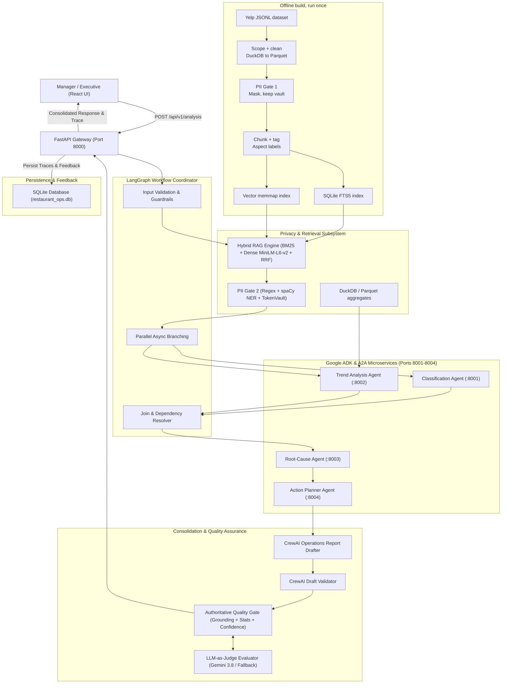

# AI-Powered Restaurant Operations & Review Assistant

An AI operational intelligence system built on the Yelp Open Dataset. It retrieves historical review evidence, coordinates specialist agents, ranks proposed corrective actions, protects PII, and validates reports before returning them to managers.

---

## Architecture Diagram & Data Flow



---

## Key Features

1. **Hybrid RAG Semantic Retrieval**:
    - BM25 full-text keyword indexing + normalized 384-dimensional `BAAI/bge-small-en-v1.5` embeddings.
   - Reciprocal Rank Fusion (RRF) and Cross-Encoder reranking over 59,894 indexed chunk vectors.
   - Metadata filtering across business IDs, cities (8 major metros), and star ratings.

2. **Specialist Agent Microservice Mesh**:
   - **Classification Agent** (Port 8001): Identifies categories (Speed of Service, Food Quality, Staff, Cleanliness, Pricing), aspects, sentiment, and severity.
   - **Trend Analysis Agent** (Port 8002): Analyzes historical complaint slopes (DuckDB parquet analytics) and satisfaction predictions.
   - **Root-Cause Analysis Agent** (Port 8003): Distinguishes acute vs chronic failure modes with explicit evidence attribution.
   - **Action Planner Agent** (Port 8004): Generates prioritized recommendations mapped to owner roles (`kitchen_manager`, `general_manager`) with measurable KPIs.

3. **CrewAI Drafting & Validation Layer**:
   - **Operations Report Drafter**: Synthesizes multi-agent outputs into an executive-ready operational brief with material claim citations and historical cutoff disclosures.
   - **Operations Report Validator**: Audits drafts against retrieved evidence chunks to catch hallucinations, numerical contradictions, or data leaks.

4. **PII Gate 2 & Privacy Safeguards**:
   - Request-scoped `TokenVault` redacting customer names, emails, phones, and card numbers into reversible tokens (`[PERSON_1]`, `[EMAIL_1]`, `[PHONE_1]`) prior to any external LLM prompt.
   - Residual leakage scanner actively blocks prompt transmission if unmasked PII is present.

5. **Authoritative Quality Gate**:
   - Evidence grounding verification, cross-business isolation checks, and contradiction detection.
   - Explainable deterministic confidence scoring formula ($0\text{--}100$):
     $$\text{Score} = 100 \times \max(0, \min(1, 0.35 R_{\text{ev}} + 0.25 T_{\text{src}} + 0.20 A_{\text{agree}} - 0.20 P_{\text{stale}}))$$
   - LLM-as-Judge evaluation with bounded timeout fallback.

6. **React Dashboard**:
  - Vite + TypeScript + Lucide operations workspace with evidence, execution traces, scenarios, agent status, and feedback.

---

## Project Structure

```text
├── app/
│   ├── api/                     # FastAPI Gateway routes, schemas, and SQLite persistence
│   │   ├── routes.py            # Endpoints: /analysis, /agents/status, /scenarios, /feedback
│   │   ├── schemas.py           # Pydantic request/response models
│   │   ├── persistence.py       # SQLite database operations (traces, logs, feedback)
│   │   └── scenarios.py         # Grounded demo scenarios from Yelp dataset
│   ├── agents/                  # 4 Specialist Agent microservices (Ports 8001-8004)
│   │   ├── classification/      # Port 8001
│   │   ├── trends/              # Port 8002
│   │   ├── root_cause/          # Port 8003
│   │   └── action_planner/      # Port 8004
│   ├── crew/                    # CrewAI drafting & validation layer
│   │   ├── consolidation.py     # Operations Report Drafter & Validator agents
│   │   └── schemas.py           # Crew report & validation models
│   ├── orchestration/           # LangGraph workflow engine
│   │   ├── graph.py             # StateGraph definition and compiled workflow
│   │   ├── nodes.py             # LangGraph node execution functions
│   │   └── state.py             # Typed orchestration state with reducers
│   ├── quality/                 # Quality Gate & Privacy
│   │   ├── confidence.py        # Explainable confidence scoring formula
│   │   ├── gate.py              # Quality Gate orchestrator
│   │   ├── grounding.py         # Evidence overlap & isolation validator
│   │   ├── judge.py             # LLM-as-Judge evaluator
│   │   └── statistical.py       # Freshness & cutoff date disclosures
│   ├── retrieval/               # Hybrid RAG engine (BM25 + Dense + RRF)
│   └── main.py                  # FastAPI Application entry point (Port 8000)
├── ui/                          # Apple-inspired React + TypeScript + Vite Dashboard
│   ├── src/
│   │   ├── components/          # Sidebar, Workspace, Results, Trace, Activity, Feedback
│   │   ├── api/client.ts        # Typed API client
│   │   └── types/index.ts       # Frontend models
│   └── package.json
├── evaluation/
│   └── deepeval_eval.py         # DeepEval recommendation evaluation benchmark
├── data_store/                  # Parquet aggregates, vector index, and SQLite DB
└── tests/                       # Automated pytest unit & integration tests
```

---

## Setup & Installation

### Prerequisites
- **Python**: 3.12+
- **Node.js**: v20+ (v25.9 tested) & npm

### 1. Python Environment Setup
```powershell
# Create and activate virtual environment
python -m venv .venv
.\.venv\Scripts\Activate.ps1

# Install required dependencies
pip install -r requirements.txt
```

### 2. Live LLM Configuration

Copy `.env.example` to `.env`, use `LLM_MODE=live` and `MOCK_LLM=0`, and configure `GOOGLE_API_KEY` or `OPENROUTER_API_KEY`. The analysis endpoint returns HTTP 503 in mock mode instead of presenting synthetic findings; service/provider failures include the reported cause.

### 3. React UI Setup
```powershell
cd ui
npm install
npm run build
cd ..
```

---

## Running the Application

### Option A: Launch All Microservices & Gateway
```powershell
# Terminal 1: Start the 4 Specialist Agents (Ports 8001, 8002, 8003, 8004)
python scripts/start_agents.py

# Terminal 2: Start the FastAPI Gateway (Port 8000)
python app/main.py
```

### Option B: Launch the React Dashboard
```powershell
# Terminal 3: Start Vite Dev Server (Port 3000)
cd ui
npm run dev
```
Open browser at `http://localhost:3000`.

---

## API Documentation & Sample Usage

The interactive Swagger UI is available at `http://localhost:8000/docs`.

### 1. Common Multi-Agent Analysis (`POST /api/v1/analysis`)
```json
{
  "query": "Customers are repeatedly complaining about slow service and long wait times. What operational issues are causing this, and what should we fix first?",
  "mode": "auto",
  "business_id": "_ab50qdWOk0DdB6XOrBitw",
  "viewer_role": "manager"
}
```

To inspect the ranked recommendations and evidence returned by a live request, run this in PowerShell after starting the gateway and agents:

```powershell
$body = @{
  query = "What recurring service delays appear in reviews, and what should management fix first?"
  mode = "auto"
  business_id = "_ab50qdWOk0DdB6XOrBitw"
  viewer_role = "manager"
} | ConvertTo-Json

$result = Invoke-RestMethod -Uri "http://localhost:8000/api/v1/analysis" `
  -Method Post -ContentType "application/json" -Body $body

$result.action_plan.ranked_actions |
  Select-Object rank, issue_summary, recommended_action, owner_role, measurable_kpi, target_value |
  Format-Table -AutoSize

$result.retrieved_evidence |
  Select-Object chunk_id, stars, text_masked |
  Format-List
```

The example displays the recommendation and evidence produced for that request; no sample response is substituted as a result.

### 2. Single Agent Direct Invocation (`POST /api/v1/analysis`)
```json
{
  "query": "Classify severe food quality and temperature complaints",
  "mode": "agent",
  "agent": "classification",
  "business_id": "_ab50qdWOk0DdB6XOrBitw"
}
```

### 3. Check Live Agent Status (`GET /api/v1/agents/status`)
Returns live connectivity and latency for ports 8001 through 8004.

### 4. Submit Manager Feedback (`POST /api/v1/feedback`)
```json
{
  "request_id": "req_12345",
  "rating": 5,
  "useful": true,
  "comment": "Accurately diagnosed dining delays and prioritized expediter staffing."
}
```

## Project Deliverables

- Architecture flow: Mermaid diagram at the top of this README, based on the supplied panel diagram.
- Design decisions and trade-offs: [docs/DESIGN.md](docs/DESIGN.md)
- Ten-minute panel demo: [docs/DEMO_SCRIPT.md](docs/DEMO_SCRIPT.md)

---

## Verification & Test Results

Run the complete automated test suite across all phases:
```powershell
$env:MOCK_LLM="1"
pytest tests -v
```

Test counts vary by checkout and configured services. Use the command above for a result from the current tree. Tests may use mock mode internally; the public analysis endpoint refuses to present mock output as a live answer.
